<div align="center">

<a href="https://99proteam.github.io/NextAdminPro/">
  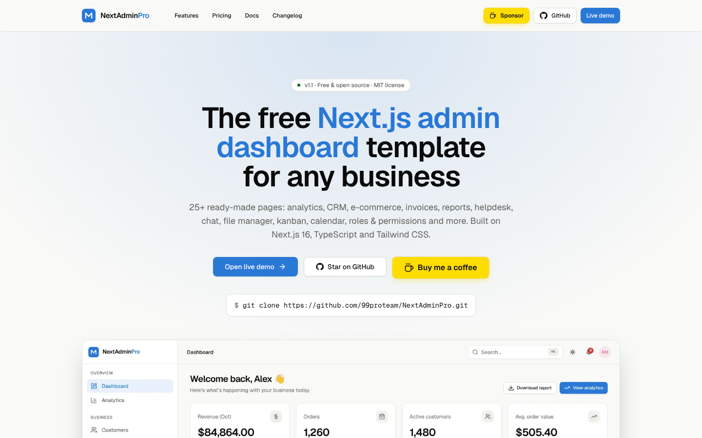
</a>

# NextAdminPro: Free Next.js Admin Dashboard Template

**A free, open-source Next.js 16 admin dashboard template and admin panel for any business.**
45+ pages and modules: analytics, CRM & deals pipeline, e-commerce, subscriptions, invoices, HR & payroll, projects, inventory, helpdesk, chat, marketing, CMS, roles & permissions and dark mode.

Built with **Next.js 16** · **React 19** · **TypeScript** · **Tailwind CSS v4** · **Radix UI** (shadcn/ui-style components)

<a href="https://buymeacoffee.com/99proteam">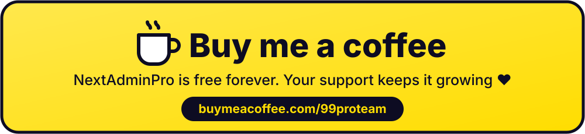</a>

<p>
  <a href="https://99proteam.github.io/NextAdminPro/"></a>
  <a href="https://buymeacoffee.com/99proteam"></a>
  <a href="https://github.com/99proteam/NextAdminPro"></a>
</p>

[](./LICENSE)
[](https://nextjs.org)
[](https://react.dev)
[](https://www.typescriptlang.org)
[](https://tailwindcss.com)
[](./CONTRIBUTING.md)

**[🚀 Live demo](https://99proteam.github.io/NextAdminPro/)** · **[📖 Docs](https://99proteam.github.io/NextAdminPro/docs/)** · **[☕ Sponsor](https://buymeacoffee.com/99proteam)** · **[🐛 Report a bug](https://github.com/99proteam/NextAdminPro/issues)**

</div>

---

> [!TIP]
> ### ☕ Support NextAdminPro
> NextAdminPro is **100% free and open source**. If it saves you time, please consider supporting its development:
>
> <a href="https://buymeacoffee.com/99proteam"></a>
>
> **[buymeacoffee.com/99proteam](https://buymeacoffee.com/99proteam)**. Every coffee funds new pages, fixes and updates. ⭐ Starring the repo helps too!

---

## Table of contents

- [Why NextAdminPro?](#why-nextadminpro)
- [Live demo](#live-demo)
- [Features](#features)
- [Screenshots](#screenshots)
- [Quick start](#quick-start)
- [Project structure](#project-structure)
- [Customization](#customization)
- [Deploy](#deploy)
- [FAQ](#faq)
- [Roadmap](#roadmap)
- [Support the project](#support-the-project)
- [License](#license)

## Why NextAdminPro?

Most admin templates are paid, outdated, or a single dashboard page with nothing behind it. NextAdminPro is a **complete, working admin panel** with 45+ pages, 40+ reusable components and a typed data layer you can point at your own API or database in an afternoon.

- ✅ **100% free**, MIT licensed. Use it for client projects, SaaS products and internal tools.
- ✅ **Latest stack**: Next.js 16 App Router, React 19, Cache Components, Turbopack.
- ✅ **Production-quality UI**: accessible, responsive and theme-aware (light, dark and six accent colors).
- ✅ **For any business**: SaaS, e-commerce, agencies, support teams, CRM and internal tools.
- ✅ **No vendor lock-in**: plain, shadcn/ui-style components you own.

## Live demo

👉 **[99proteam.github.io/NextAdminPro](https://99proteam.github.io/NextAdminPro/)**

The demo is a static export deployed to GitHub Pages by the included GitHub Action on every push to `main`. Use any email and password on the login page.

## Features

### Pages & modules

| Module | What's included |
| --- | --- |
| 📊 **Dashboard** | KPI cards with trends, revenue vs. last year, sales by category, recent orders, top products, activity feed, getting-started checklist |
| 📈 **Analytics** | Traffic and page views, device split, conversion funnel, revenue vs. expenses, traffic sources, top countries, daily sign-ups |
| 📑 **Reports** | Profit & loss, monthly performance table, one-click exports (CSV), scheduled daily/weekly/monthly reports, custom report builder |
| 👥 **Customers (CRM)** | Advanced table, add/edit/delete, bulk activate/block, customer profile with lifetime value and order history |
| 📦 **Products & inventory** | Table and grid views, stock status, low-stock alerts, one-click restock, margin column, add/edit dialog |
| 🛒 **Orders** | Status tabs, bulk fulfilment, order detail with fulfilment tracker, status updates, refunds, print |
| 🧾 **Invoices** | Paid/outstanding/overdue summary, line-item invoice builder, reminders, printable invoice (save as PDF) |
| 🏷️ **Coupons** | Percentage, fixed and free-shipping discount codes, usage limits, schedules, code generator, pause/resume |
| ✅ **Tasks (Kanban)** | Drag-and-drop board, priorities, tags, assignees, due dates, filters |
| 📅 **Calendar** | Month view, event categories, day agenda, upcoming events, double-click to create |
| ✉️ **Inbox** | Folders, unread state, star/archive/spam/delete, reading pane, reply, compose |
| 💬 **Team chat** | Channels and direct messages, emoji reactions, typing indicator, unread counts |
| 📁 **File manager** | Folders, drag-and-drop upload, grid/list views, starring, sharing, rename, storage usage by type |
| 🛟 **Support helpdesk** | Multi-channel tickets (email, chat, phone, web), SLA timers, assignment, quick replies, conversation drawer |
| 🛡️ **Roles & permissions** | Team management, invites, role changes, 2FA status, RBAC permission matrix |
| 📜 **Audit log** | Filterable, exportable activity history with severity levels |
| 🔔 **Notifications** | Notification center, filters, mark as read, per-event preferences |
| ⚙️ **Settings** | Profile, workspace, password strength meter, 2FA, sessions, billing plans and usage, API keys, webhooks, appearance |
| 🤝 **Deals pipeline** | Drag-and-drop sales pipeline by stage, weighted forecast, win rate, board and table views |
| 🔁 **Subscriptions** | MRR/ARR, churn, plans, seats, renewals, MRR growth chart, retry or cancel |
| 💳 **Transactions** | Charges, refunds, fees and payouts with method and status filters, one-click refunds |
| ⭐ **Reviews** | Rating breakdown, moderation queue, publish/hide, verified buyers, replies |
| 🚚 **Shipments** | Multi-carrier tracking, routes, ETAs, exceptions and customer notifications |
| 🏭 **Vendors** | Supplier directory with categories, payment terms, ratings and spend |
| 📋 **Purchase orders** | Create, send, receive and cancel POs, with committed spend |
| 📦 **Warehouses & stock** | Capacity per location and a full stock-movement ledger (inbound, outbound, transfers) |
| 🧾 **Expenses** | Submit, approve, reject and reimburse spending, with missing-receipt alerts |
| ✍️ **Contracts** | Agreements with e-signature status, renewal dates and expiry warnings |
| 📂 **Projects** | Budget vs. spend, progress, team and deadlines, with at-risk tracking |
| ⏱️ **Timesheets** | Live timer, billable hours, utilisation and per-project time |
| 🗓️ **Appointments** | Bookings with today’s schedule, hosts, locations and no-show rate |
| 👔 **Employees (HR)** | Team directory, departments, employment type, salary and status |
| 🌴 **Time off** | Leave requests with approve/reject workflow and team availability |
| 💵 **Payroll** | Monthly pay runs with gross, taxes, benefits, net pay and payslip export |
| 📣 **Campaigns** | Email/SMS/push campaigns with open, click and revenue tracking |
| 📰 **Blog / CMS** | Posts with categories, tags, scheduling and view counts |
| 📚 **Knowledge base** | Help-center articles by collection with helpfulness scores |
| 🔌 **Integrations** | App marketplace (Stripe, Slack, HubSpot, Zapier…) with connect and configure |
| 🧩 **UI components** | 40+ components: buttons, badges, forms, dialogs, dropdowns, tabs, accordion, alerts, stepper, slider, radio cards, toggle groups, combobox, tag input, OTP input, star rating, file dropzone, timeline, breadcrumb, pagination, hover card, context menu, copy button, code block, spinner, kbd, sparkline, avatar group, empty states |
| 🔐 **Auth pages** | Login, register and forgot password with validation and OAuth buttons |
| 🌐 **Public pages** | Landing page, pricing page template, documentation, changelog and 404 |

### Built into every page

- **Reusable CRUD engine** (`src/components/crud`): stats, advanced table, filters, bulk actions and an auto-generated add/edit form. Build a new module in ~100 lines
- **Collapsible, filterable sidebar** grouped by business area

- **⌘K / Ctrl+K command palette**: search pages, customers, orders and products, or switch theme
- **Keyboard shortcuts**: `G` + letter to navigate, `Ctrl/⌘+B` to toggle the sidebar, `?` for the cheat sheet
- **Quick-create menu** for customers, products, invoices, events and tickets
- **Reusable `<DataTable>`**: search, faceted filters, sorting, pagination, column visibility, row selection, bulk actions, CSV export and grid view
- **Dark mode and six accent themes**, driven by CSS design tokens and remembered per user
- **Collapsible sidebar** (state is remembered) and slide-out navigation on mobile
- **Breadcrumbs, toasts, confirm dialogs, loading skeletons and error boundaries**
- **SEO-ready**: metadata, Open Graph, Twitter cards, `sitemap.xml`, `robots.txt`, web manifest and JSON-LD (SoftwareApplication + FAQ)
- **Accessible**: keyboard navigation, ARIA labels, and status shown with icon + label (never color alone)
- **Print styles** for invoices and orders

## Screenshots

| Dashboard (light) | Dashboard (dark) |
| --- | --- |
| 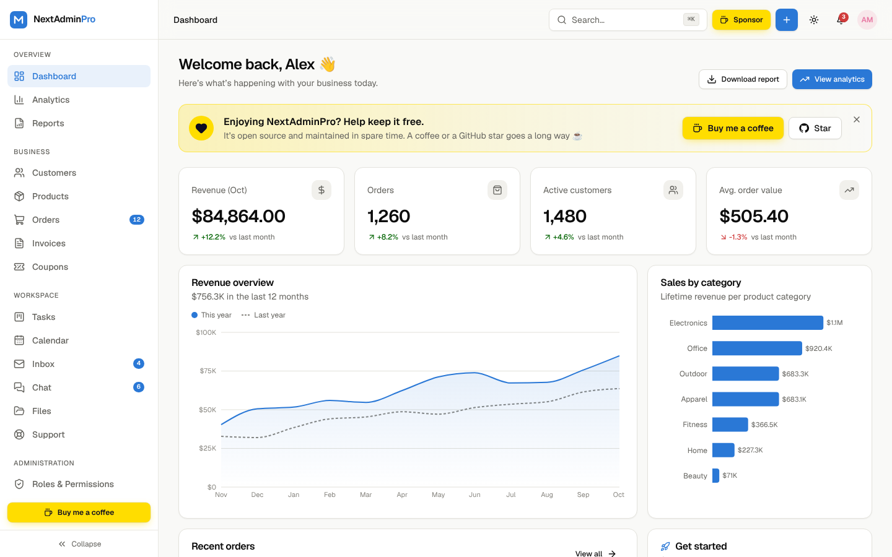 | 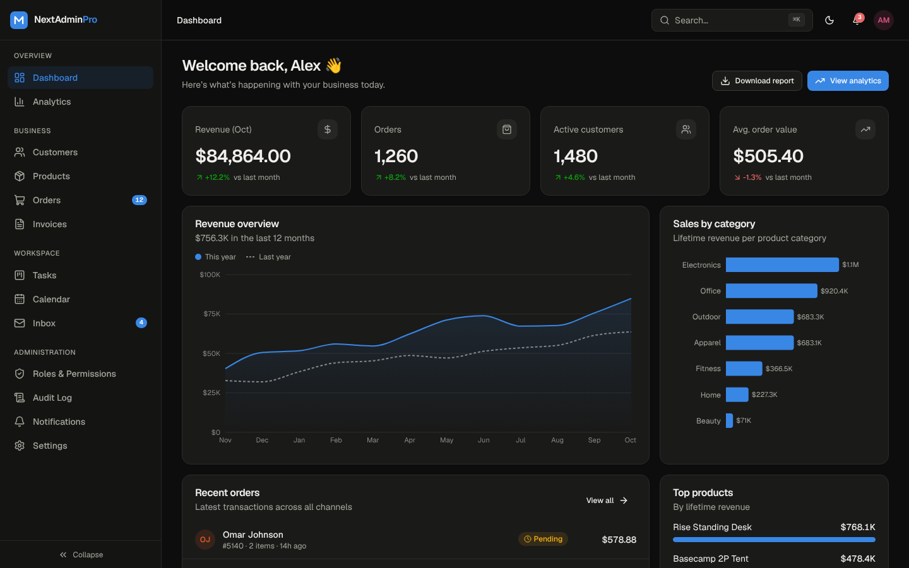 |
| **Analytics** | **Reports & P&L** |
| 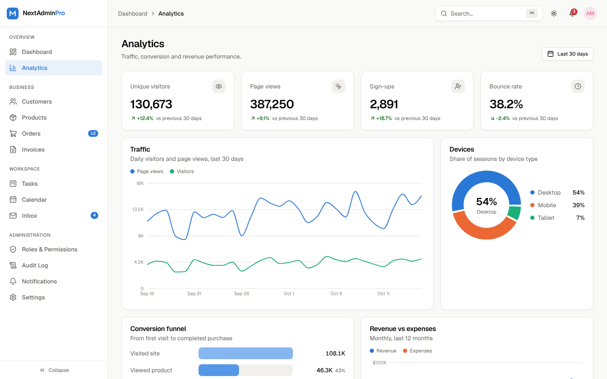 | 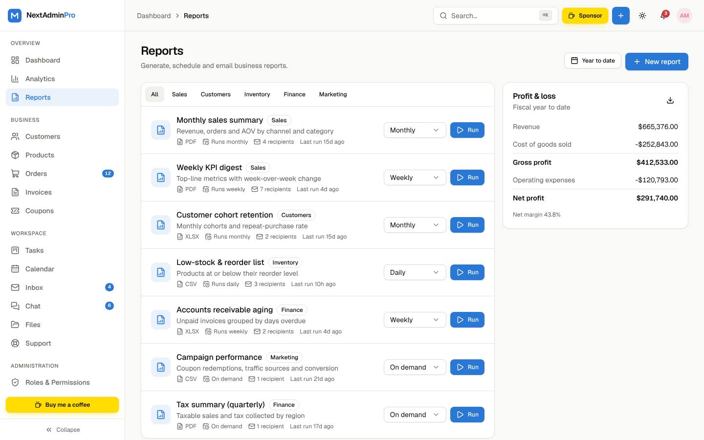 |
| **Customers (CRM)** | **Support helpdesk** |
| 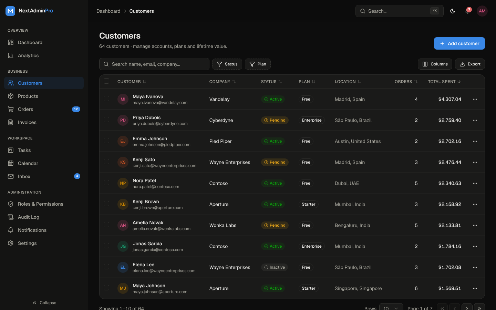 | 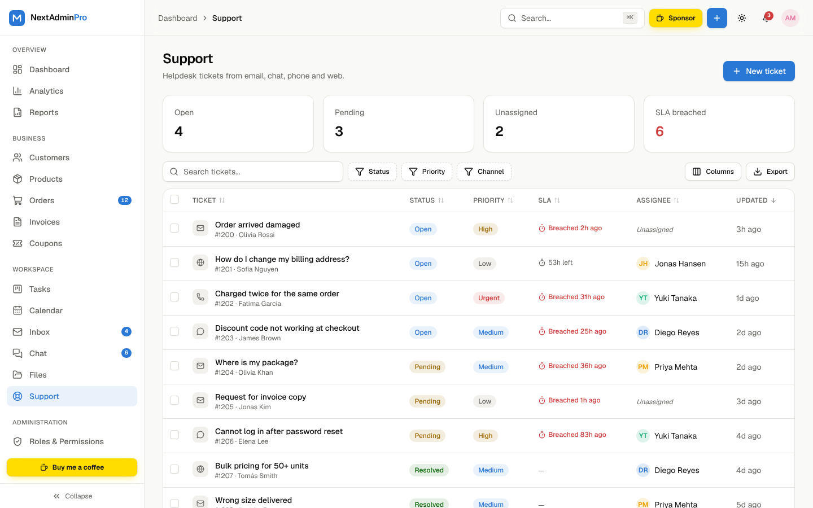 |
| **Kanban tasks** | **File manager** |
| 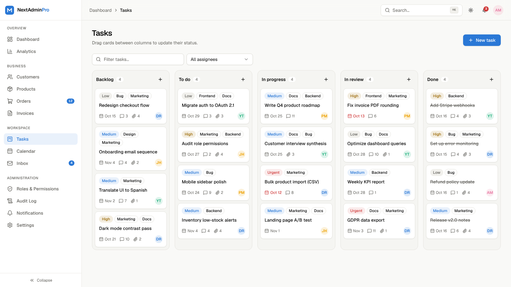 | 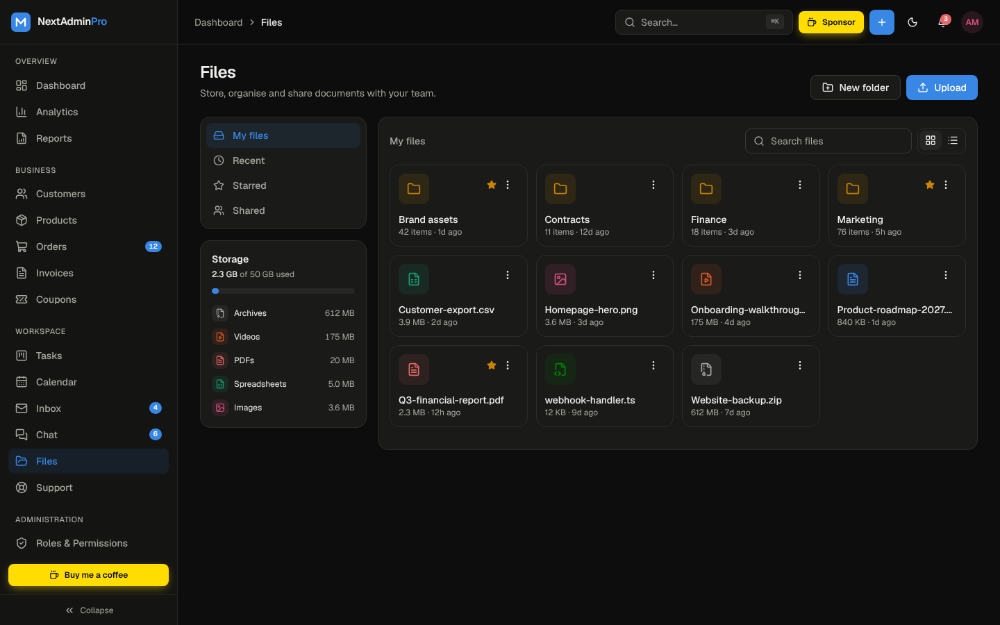 |
| **Team chat** | **Printable invoice** |
| 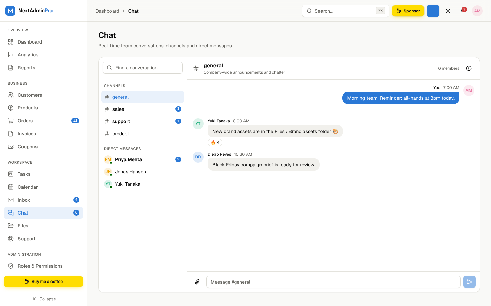 | 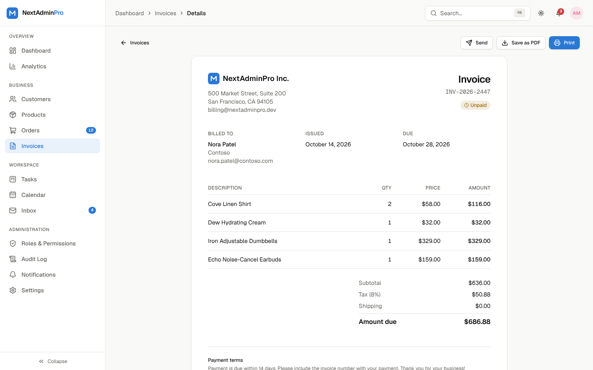 |
| **Deals pipeline** | **Warehouses & stock** |
| 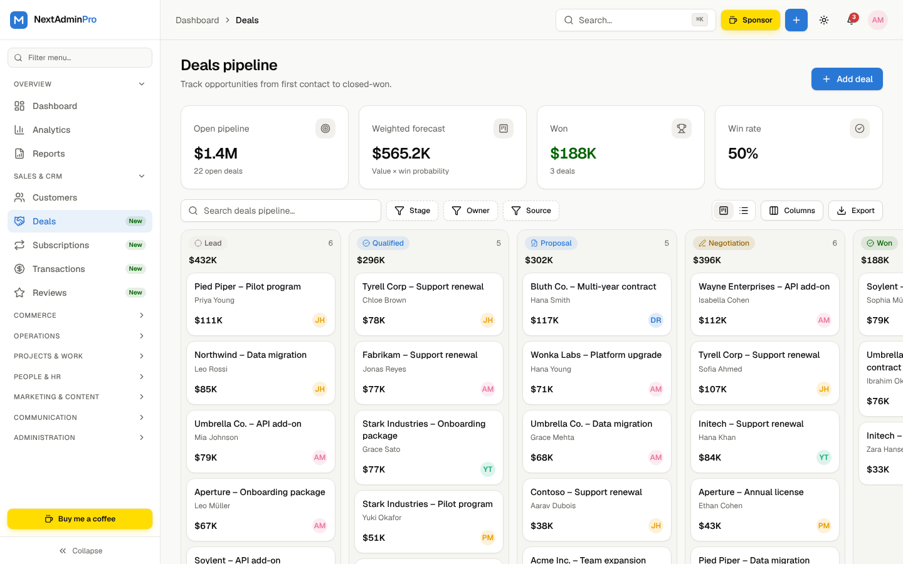 | 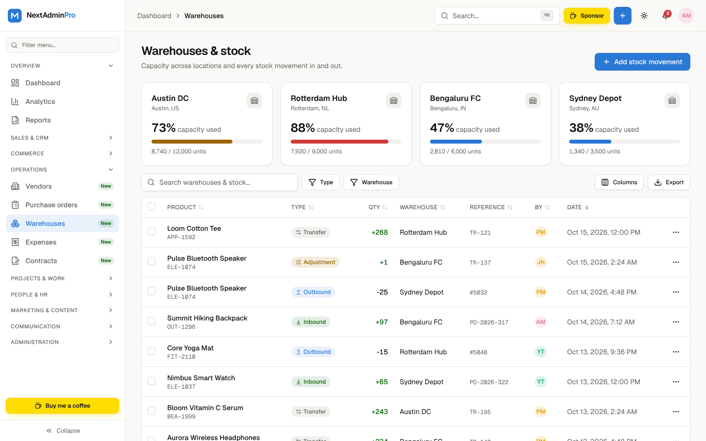 |
| **Employees (HR)** | **Subscriptions & MRR** |
| 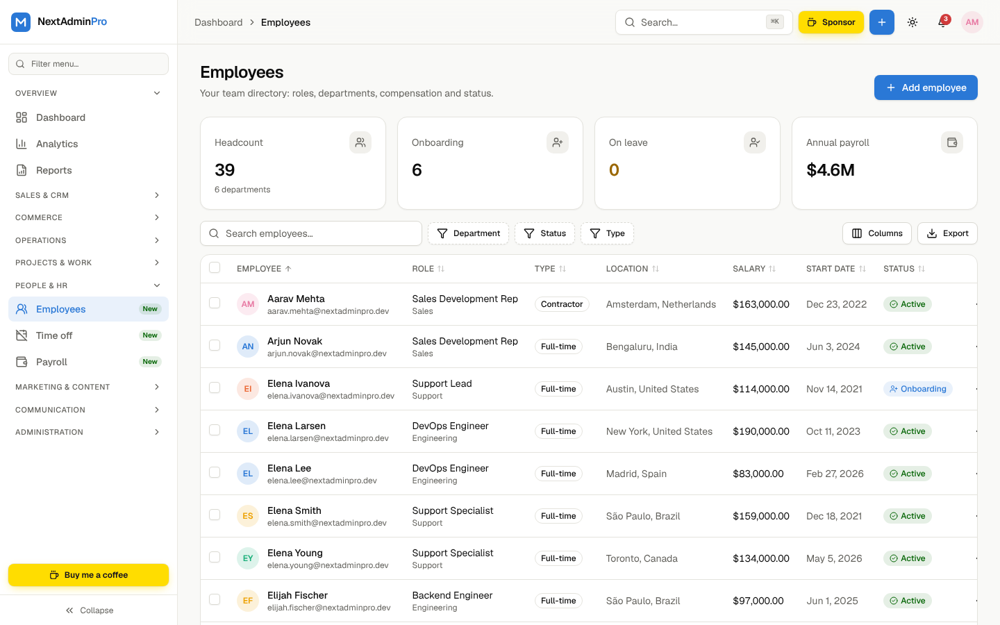 | 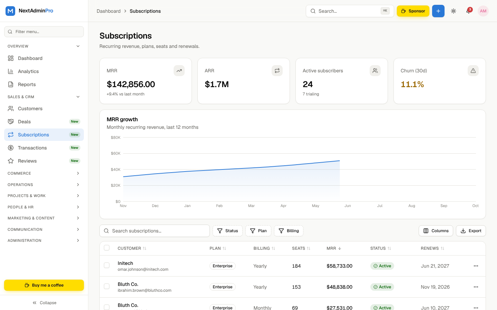 |
| **Projects** | **Integrations** |
| 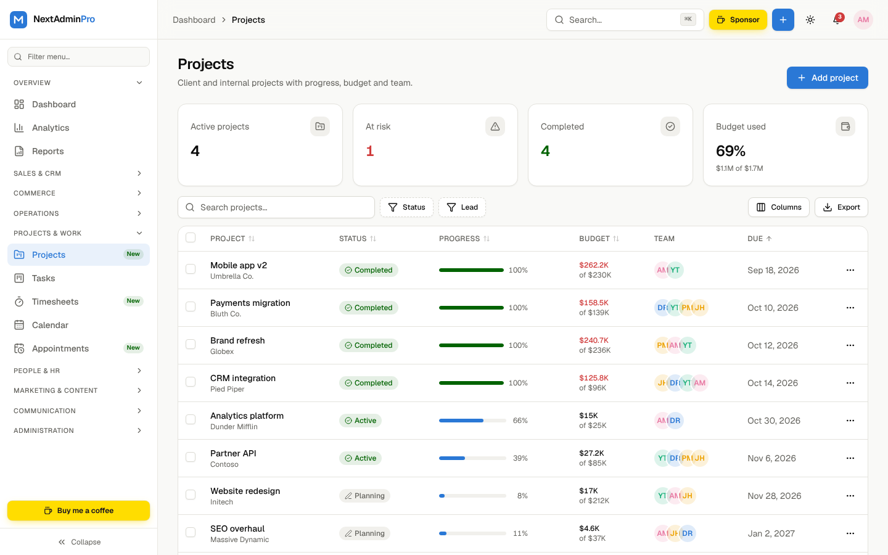 | 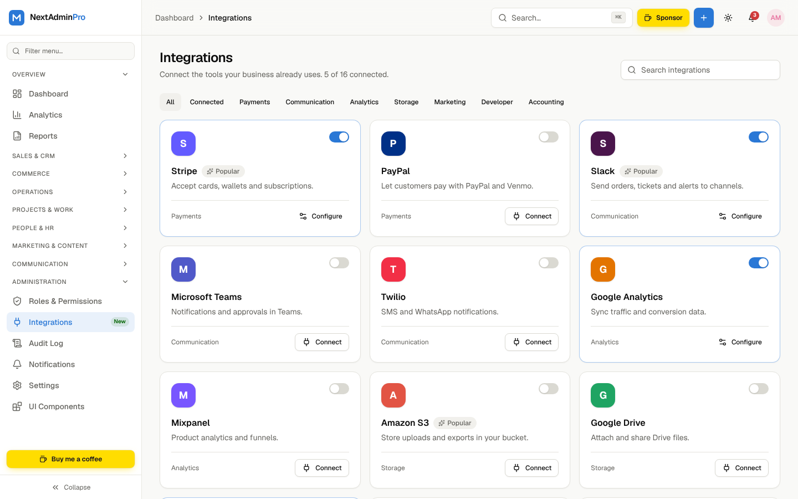 |

<p align="center">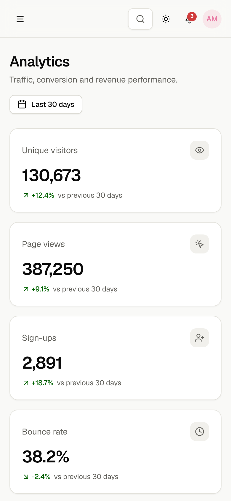</p>

## Quick start

**Requirements:** Node.js 20.9 or newer.

```bash
git clone https://github.com/99proteam/NextAdminPro.git
cd NextAdminPro
npm install
npm run dev
```

Open [http://localhost:3000](http://localhost:3000). The dashboard lives at `/dashboard`.

| Script | Description |
| --- | --- |
| `npm run dev` | Start the dev server (Turbopack) |
| `npm run build` | Production build (Node.js server) |
| `npm run start` | Serve the production build |
| `npm run build:pages` | Static export to `out/` (GitHub Pages, Netlify, S3…) |
| `npm run lint` | Lint with ESLint |
| `npm run typecheck` | Type-check with TypeScript |

## Project structure

```
src/
├── app/
│   ├── (auth)/              # login, register, forgot-password
│   ├── dashboard/           # every admin page
│   ├── docs/ pricing/ changelog/
│   ├── layout.tsx           # root layout, metadata, theme providers
│   ├── page.tsx             # landing page
│   └── globals.css          # design tokens (colors, radius, chart palette)
├── components/
│   ├── ui/                  # buttons, cards, dialogs, selects, tables…
│   ├── data-table/          # the reusable advanced <DataTable>
│   ├── charts/              # Recharts wrappers that follow the theme
│   ├── layout/              # sidebar, header, command palette, shortcuts
│   ├── marketing/           # public site header and footer
│   └── <feature>/           # page-specific client components
├── config/
│   ├── navigation.ts        # sidebar and command-palette menu
│   └── site.ts              # name, URLs, sponsor link, SEO keywords
└── lib/
    ├── data/                # typed mock data, the one place to swap for a real API
    ├── permissions.ts       # RBAC roles, resources and the default matrix
    └── utils.ts             # formatting, CSV export, cn()
```

## Customization

### Branding and colors

All colors are CSS variables in [`src/app/globals.css`](./src/app/globals.css). Change `--primary` to rebrand, or add an accent preset next to the existing `[data-accent="…"]` blocks. Update the name, URLs, sponsor link and SEO keywords in [`src/config/site.ts`](./src/config/site.ts).

### Navigation

Add, remove or reorder sidebar items in [`src/config/navigation.ts`](./src/config/navigation.ts). The command palette and breadcrumbs pick up changes automatically.

### Connect your own data

Every page reads from [`src/lib/data`](./src/lib/data). Replace the mock arrays with your API, database (Prisma, Drizzle, Supabase…) or a headless CMS:

```ts
// src/app/dashboard/customers/page.tsx
import { db } from "@/lib/db";

export default async function CustomersPage() {
  const customers = await db.customer.findMany();
  return <CustomersView initial={customers} />;
}
```

The types in [`src/lib/data/types.ts`](./src/lib/data/types.ts) describe the shape each page expects. See the [documentation](https://99proteam.github.io/NextAdminPro/docs/) for more.

### Authentication

The auth pages are UI only, so you can plug in [Auth.js](https://authjs.dev), [Better Auth](https://www.better-auth.com), [Clerk](https://clerk.com) or [Supabase Auth](https://supabase.com/auth). Protect `/dashboard` with a [`proxy.ts`](https://nextjs.org/docs/app/api-reference/file-conventions/proxy) or in the dashboard layout, and enforce `src/lib/permissions.ts` on the server.

## Deploy

**Vercel**

[](https://vercel.com/new/clone?repository-url=https%3A%2F%2Fgithub.com%2F99proteam%2FNextAdminPro)

**GitHub Pages (static):** fork the repo, then go to **Settings → Pages → Build and deployment** and choose **Deploy from a branch → `gh-pages` / root**. The workflow in `.github/workflows/deploy-demo.yml` builds and publishes on every push to `main`.

**Anywhere else:** `npm run build && npm run start` on any Node.js host (Railway, Render, Fly.io, Docker…), or `npm run build:pages` for static hosting. Set `NEXT_PUBLIC_SITE_URL` to your domain (see [`.env.example`](./.env.example)).

## FAQ

<details>
<summary><b>Is NextAdminPro really free?</b></summary>

Yes. It's MIT licensed, so you can use it for personal, client and commercial projects at no cost.
</details>

<details>
<summary><b>Is it compatible with shadcn/ui?</b></summary>

Yes. The components use the same patterns as shadcn/ui (Radix UI + Tailwind CSS + class-variance-authority), so you can add shadcn components alongside them.
</details>

<details>
<summary><b>Can I use it with my own backend?</b></summary>

Yes. Swap the mock data in `src/lib/data` for Prisma, Drizzle, Supabase, Firebase or any REST/GraphQL API.
</details>

<details>
<summary><b>Does it support dark mode?</b></summary>

Yes. Light, dark and system modes plus six accent colors, all switchable at runtime and remembered per user.
</details>

<details>
<summary><b>How can I support the project?</b></summary>

⭐ Star the repo, share it, contribute, or <a href="https://buymeacoffee.com/99proteam">buy me a coffee</a>.
</details>

## Roadmap

- [x] Reports, coupons, chat, file manager and helpdesk modules
- [x] Live demo on GitHub Pages
- [x] 20 more modules: deals, subscriptions, HR, payroll, projects, inventory, contracts, campaigns, CMS and more
- [ ] Database starter (Prisma + PostgreSQL) with Server Actions
- [ ] Auth integration example
- [ ] Internationalization (i18n) and RTL
- [ ] More pages: invoices PDF export, CRM deals pipeline, HR/employees
- [ ] Storybook for UI components

Have an idea? [Open a feature request](https://github.com/99proteam/NextAdminPro/issues/new?template=feature_request.md).

## Support the project

<div align="center">

If NextAdminPro helps you build faster, please support it ❤️

<a href="https://buymeacoffee.com/99proteam"></a>

**[buymeacoffee.com/99proteam](https://buymeacoffee.com/99proteam)** · ⭐ **[Star on GitHub](https://github.com/99proteam/NextAdminPro)**

</div>

## Contributing

Contributions are welcome! Read the [contributing guide](./CONTRIBUTING.md) to get started.

## License

[MIT](./LICENSE) © 99proteam. Free for personal and commercial use.

---

<sub>**Keywords:** nextjs admin dashboard, crm pipeline, hr dashboard, payroll dashboard, inventory management, project management dashboard, saas subscription dashboard, next.js admin template, nextjs admin panel, free admin dashboard template, open source admin dashboard, react admin dashboard, tailwind css admin template, shadcn admin dashboard, typescript admin panel, saas dashboard template, ecommerce admin dashboard, crm dashboard, helpdesk dashboard, nextjs 16 template, react 19 dashboard, radix ui admin, kanban board, invoice template, file manager, chat ui</sub>
